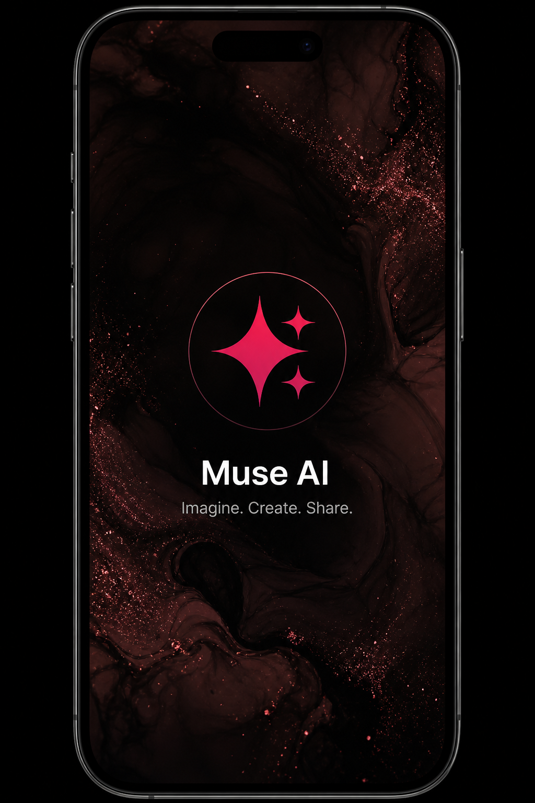
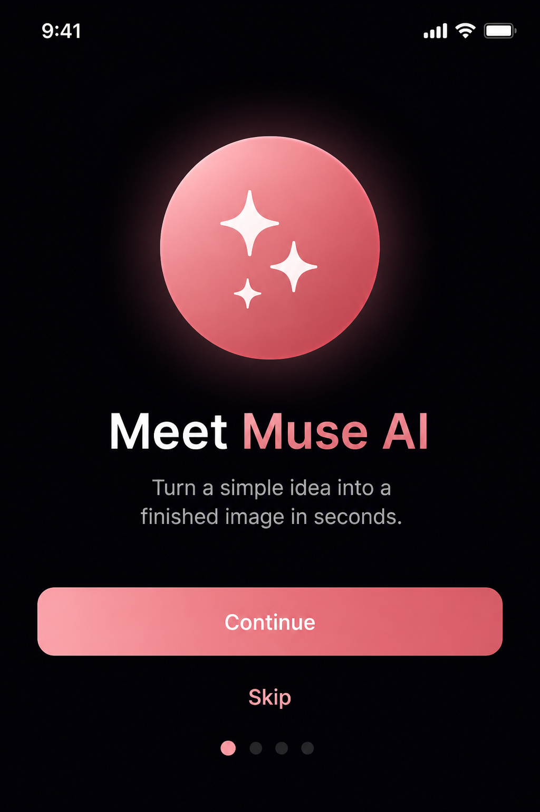
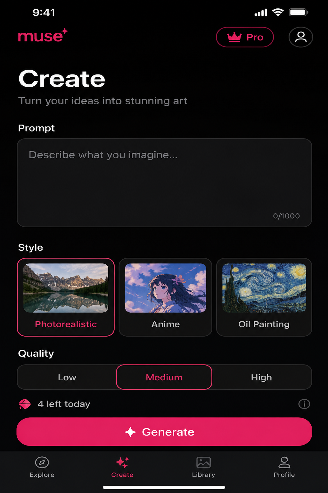
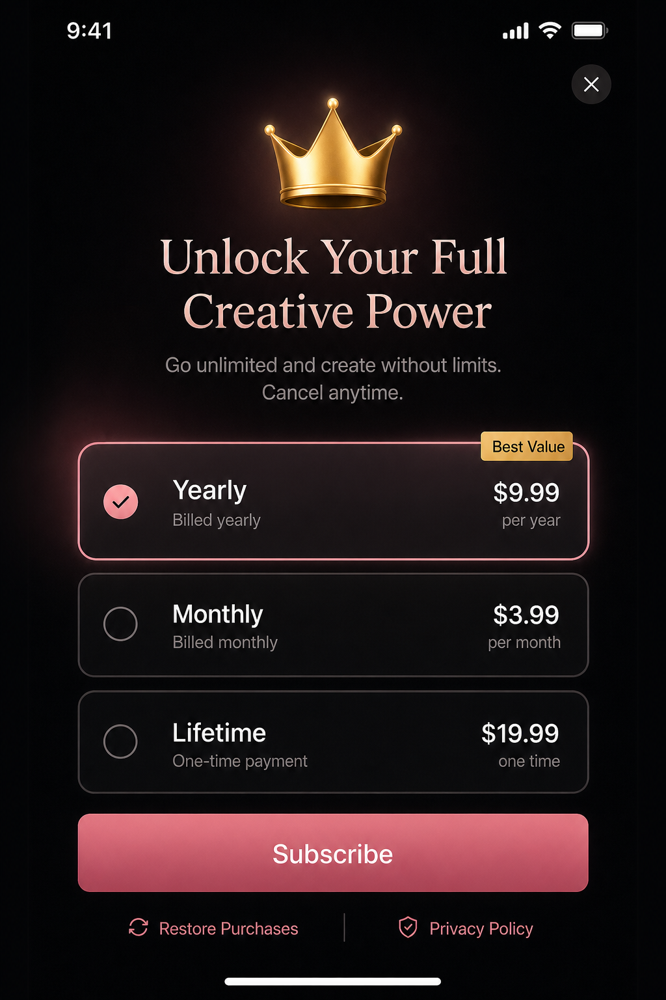
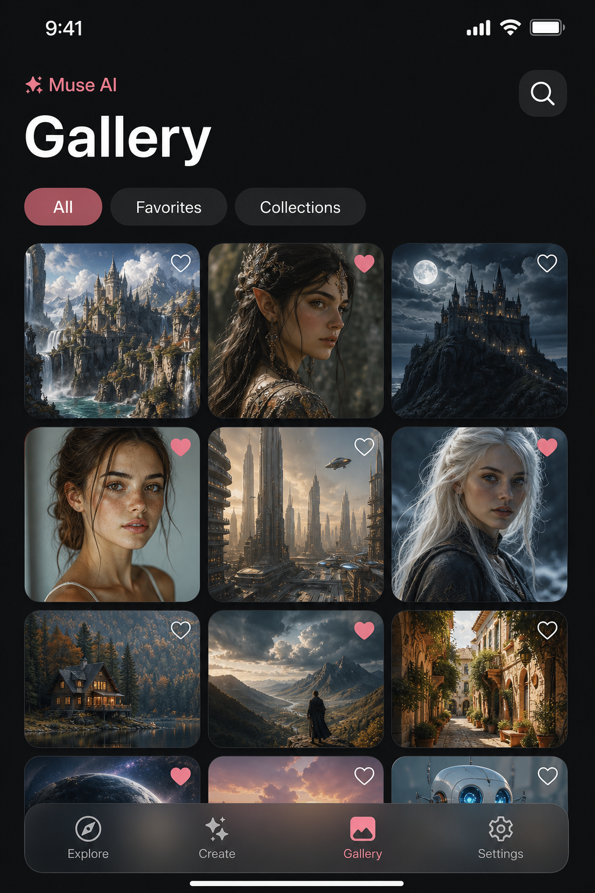
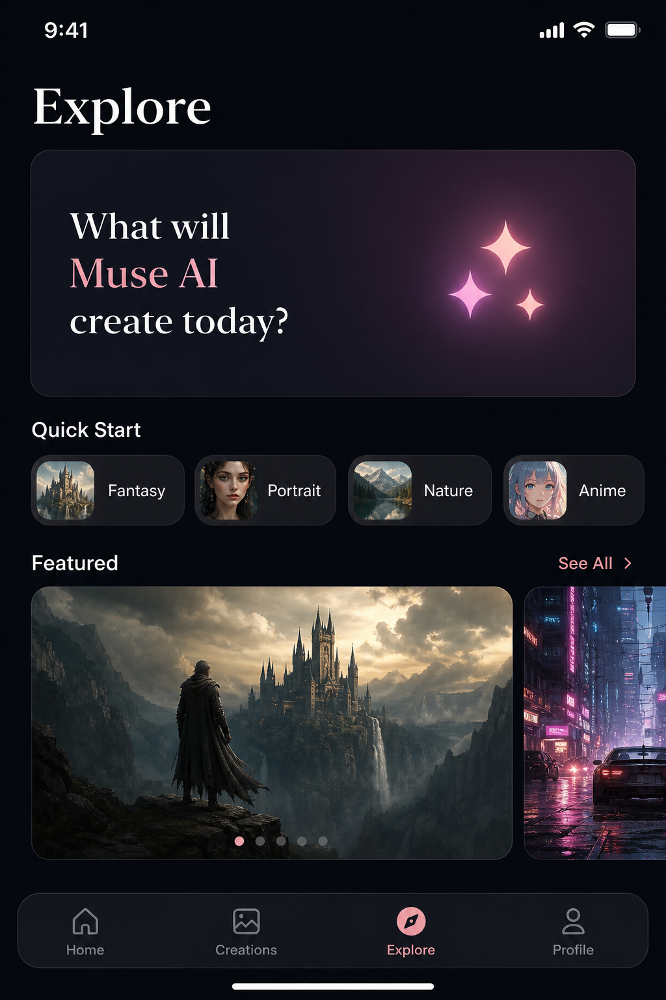
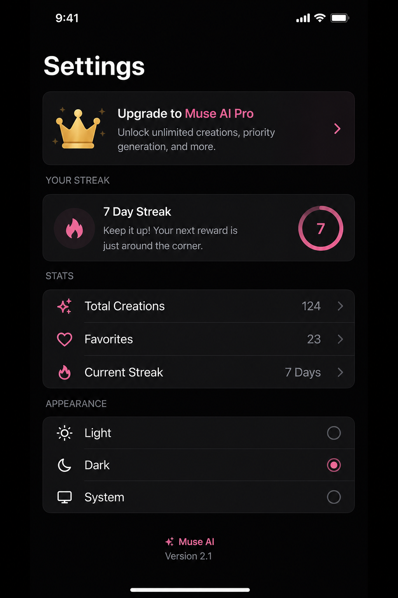

<div align="center">


# Muse AI — iOS AI Image Generator

**Imagine. Create. Share.** — v2.1

A complete, production-ready SwiftUI source code template for a AI-powered image generation app, with StoreKit 2 subscriptions, widget extension, and full App Store listing assets.

  

</div>

---

## 📱 Screenshots

| Splash | Onboarding | Create |
|:---:|:---:|:---:|
|  |  |  |

| Paywall | Gallery | Explore | Settings |
|:---:|:---:|:---:|:---:|
|  |  |  |  |

## ✨ Features

- **AI Image Generation** — text-to-image via OpenAI (DALL·E) with style presets, negative prompts and batch generation
- **Prompt AI Tools** — automatic prompt enhancement and image analysis (`OpenAIService`)
- **StoreKit 2 Monetization** — subscription paywall with a local testing config (`Products.storekit`)
- **Generation Queue** — background batch queue with progress (`GenerationQueue`)
- **Gallery & Explore** — local gallery management, upscaled images (`ImageUpscaler`), sharing
- **Widget Extension** — Home Screen widget (`ArtGeneratorWidget`)
- **App Intents** — Siri / Shortcuts support
- **Retention & Growth** — streaks, achievements, referrals, review prompts, AB testing, haptics, sound
- **Full App Store Assets** — listing description, keywords, preview images and banner included

## 🚀 Getting Started

1. **Open the project**
   ```bash
   cd MuseAI-MainFile/ArtGenerator
   open ArtGenerator.xcodeproj
   ```
2. **Add your OpenAI API key** — open `ArtGenerator/Configurations/AppConfig.swift` and replace:
   ```swift
   static let apiKey: String = "YOUR_OPENAI_API_KEY"
   ```
   > Buyers must use their own paid OpenAI API account and credits. Never commit a real key to source control.
3. **Backend proxy (recommended for production)** — set `useBackendProxy = true` and `backendProxyBaseURL` in `AppConfig.swift`, and forward requests from your server to OpenAI so the real key never ships inside the app binary.
4. **Run** on a simulator or device (iOS 16+).

### Testing purchases

The project ships with `ArtGenerator/Products.storekit` for local StoreKit testing — no App Store Connect setup needed to try the paywall.

## 📂 Project Structure

```
MuseAi/
├── MuseAI-MainFile/          # Xcode source project
│   ├── ArtGenerator/         # Main app target
│   └── ArtGeneratorWidget/   # Home Screen widget extension
├── Screenshots/              # App Store screenshots (7)
├── Documentation/            # Docs
├── description-updated.html  # App Store listing description
├── muse-ai-app-icon.png      # App icon asset
├── muse-ai-banner.png        # Marketing banner
└── tags.txt                  # App Store keywords/tags
```

## 🏷️ Keywords

`ios app` · `swiftui` · `ai image generator` · `storekit` · `xcode` · `source code` · `subscription` · `mobile app` · `image generation` · `ios template`

---

<div align="center">

Built with ❤️ in SwiftUI

</div>
